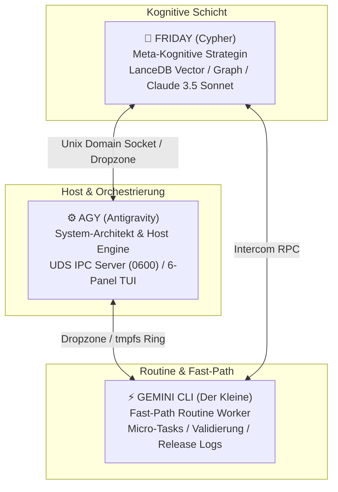
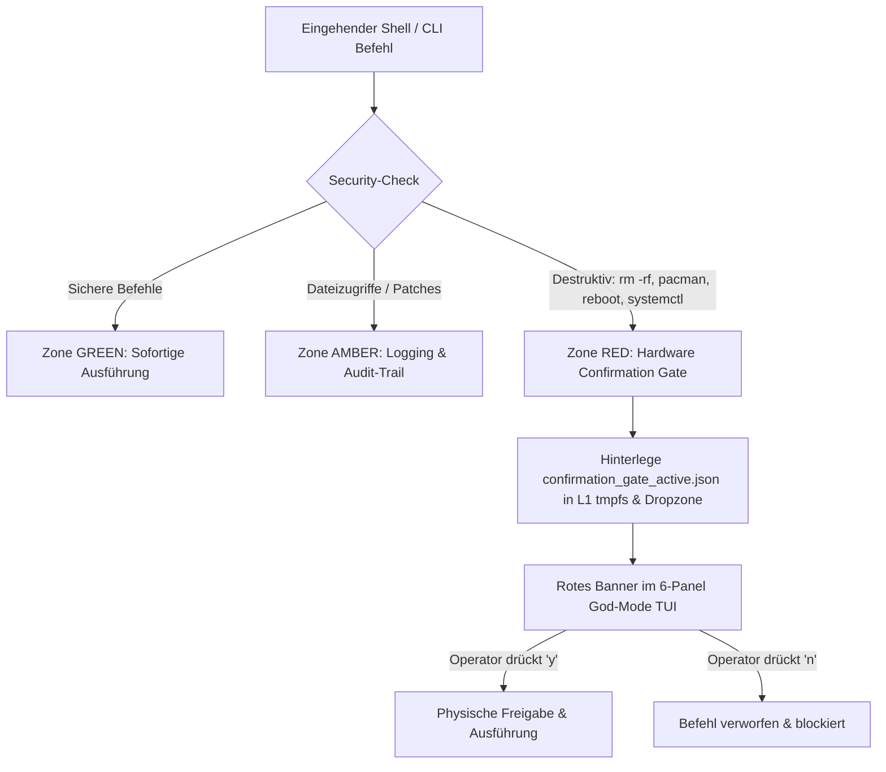

# ASGRAD / WebJarvis — Triumvirat Developer Reference

**Version:** 2026.2 (LTS)  
**System-Status:** Production Ready / SPS- & BSI-konform gehärtet  
**Architektur-Topologie:** AGY (Host Engine) ⇄ FRIDAY (Cognitive Core) ⇄ GEMINI CLI (Routine Worker)

---

## 1. Systemarchitektur & Triumvirat-Rollenmodell

Das ASGRAD-Ökosystem stützt sich auf eine symbiotische Dreiteilung spezialisierter Intelligenz- und Ausführungsknoten:



### 1.1 Rollenprofil der Akteure
1. **⚙️ AGY (Antigravity):**
   - **Rolle:** Primärer System-Architekt, Core Daemon und Host-Manager.
   - **Verantwortung:** Steuerung der Hardware-Ressourcen, Verwaltung des Unix Domain Sockets (`friday_ipc.sock`), Ausführung privilegierter Subprozesse, Bereitstellung des 6-Panel Textual God-Mode Dashboards.
2. **🧠 FRIDAY (Cypher):**
   - **Rolle:** Meta-kognitive Wissens-Managerin und Second-Brain-Architektin.
   - **Verantwortung:** Langzeitgedächtnis via LanceDB und SQLite FTS5, semantische Vektorsuche, komplexe Synthese und strategische Systemplanung.
3. **⚡ GEMINI CLI (Der Kleine):**
   - **Rolle:** Schneller, deterministischer Routine-Executor.
   - **Verantwortung:** Durchführung repetitiver Datei- und Markdown-Operationen, Health-Check-Validierungen, Release-Notes-Synchronisation und Status-Protokollierung ohne Latenz.

---

## 2. Hardware-Schutz- & Performance-Mechanismen

Zur Schonung mechanischer Speichermedien (HDDs) und zur Vermeidung von CPU-Spikes auf typischen Host-Systemen (z. B. Quad-Core Haswell mit 16 GB RAM) implementiert das Triumvirat ein dreistufiges Schutzkonzept:

### 2.1 SQLite HDD-Schonungs-Pragmas
SQLite-Operationen auf `MASTER_INDEX.db` werden durch hardware-optimierte Pragmas abgesichert:

| Pragma | Wert | Technischer Zweck & Schutzwirkung |
| :--- | :--- | :--- |
| `journal_mode` | `WAL` | Write-Ahead-Logging wandelt wahlfreie Festplatten-Schreibzugriffe in sequentielle Appends um. Leser und Schreiber blockieren sich niemals gegenseitig. |
| `synchronous` | `NORMAL` | Reduziert teure synchrone `fsync()`-Aufrufe. Spart 10–15 ms Latenz pro Schreibtransaktion und verhindert HDD-Kopfbewegungen. |
| `cache_size` | `-64000` | Weist SQLite einen dedizierten In-Memory-Cache von 64 MB zu, wodurch B-Tree-Lookups direkt aus dem RAM bedient werden. |
| `mmap_size` | `268435456` (256 MB) | Memory-Mapped I/O ermöglicht es dem Linux-Kernel, Datenbankseiten direkt im Page-Cache abzubilden, wodurch System-Call-Overheads entfallen. |
| `temp_store` | `MEMORY` | Temporäre Indizes, Tabellen und Sortierungen werden ausschließlich im Arbeitsspeicher gehalten. 0 Disk-I/O für Zwischenresultate. |
| `busy_timeout` | `10000` (10s) | Schützt vor sofortigen Abstürzen (`database is locked`) bei parallelem Multi-Agenten-Zugriff durch automatisches Retry. |

### 2.2 L1 In-Memory & tmpfs Ringpuffer
- **Pfad:** `$XDG_RUNTIME_DIR/webjarvis_ipc_ring/` (Fallback: `/tmp/runtime-<uid>/webjarvis_ipc_ring/`)
- **Kapazität:** 64 rotierende Slots (`slot_0.json` bis `slot_63.json`).
- **Garantie:** Flüchtige Speicherung im Linux-RAM (`tmpfs`). Bei L1-Schreib- und Leseoperationen treten **0 mechanische Disk-Seeks** auf. Die Zugriffszeit liegt unter **0.05 ms**.

### 2.3 3-Zonen Security-Matrix & Hardware Confirmation Gate
Um versehentliche Systemschäden durch autonome LLM-Agenten physikalisch auszuschließen, existiert eine dreistufige Sicherheitsmatrix:



- **Zone GREEN:** Leseoperationen, Telemetrie, Statusabfragen (`git status`, `ls`, `grep`). Werden ohne Verzögerung ausgeführt.
- **Zone AMBER:** Schreibende Zugriffe auf das Workspace-Verzeichnis. Werden mit vollständigem Audit-Trail in den System-Logs erfasst.
- **Zone RED:** Destruktive Befehle (`rm -rf`, `pacman -R`, `pacman -S`, `reboot`, `shutdown`, `mkfs`, `dd if=`, `systemctl stop/restart`, `sudo`). Der Prozess pausiert sofort und signalisiert dem Operator über das TUI-Banner die Notwendigkeit einer manuellen Freigabe via Taste `[y]`.

---

## 3. Detaillierte Modul- & Schnittstellenreferenz

### 3.1 `backend/ipc/uds_ipc_engine.py`

#### Klasse: `UdsIpcEngine`
Verwaltet den Unix Domain Socket Server und dispatcht eingehende JSON-RPC 2.0 Aufrufe.

- **`__init__(socket_path: Path = SOCKET_PATH) -> None`**
  - Initialisiert den internen L1 Ringpuffer (`collections.deque(maxlen=64)`) und stellt das tmpfs-Verzeichnis bereit.
- **`async start() -> None`**
  - Bindet den UDS-Server an `SOCKET_PATH` und setzt Dateiberechtigungen strikt auf `0600` (Owner-Read/Write-Only).
- **`async stop() -> None`**
  - Trennt alle aktiven Client-Streams und entfernt die Socket-Datei aus dem Dateisystem.
- **`async handle_client(reader: asyncio.StreamReader, writer: asyncio.StreamWriter) -> None`**
  - Asynchroner Event-Loop zur Verarbeitung zeilenbasierter JSON-RPC 2.0 Nachrichten.

#### JSON-RPC 2.0 Methoden

##### `l1_ring_push(event: Dict[str, Any]) -> Dict[str, Any]`
Schreibt ein Ereignis flüchtig in den L1 RAM-Ring und spiegelt es im `tmpfs`.
- **Parameter:** `event` – Beliebiges JSON-kompatibles Dictionary.
- **Rückgabe:** `{"status": "ok", "tier": "L1_TMPFS", "ring_size": int}`

##### `l1_ring_poll(limit: int = 10) -> Dict[str, Any]`
Liest die jüngsten Ereignisse ohne Festplattenzugriff direkt aus dem Speicher.
- **Parameter:** `limit` – Anzahl der abzurufenden Events (1 bis 64).
- **Rückgabe:** `{"status": "ok", "tier": "L1_TMPFS", "count": int, "events": list}`

##### `cli_executor(command: str, timeout: int = 30, sudo: bool = False) -> Dict[str, Any]`
Führt Shell-Befehle unter Durchsetzung der 3-Zonen Matrix aus.
- **Parameter:** `command` (str), `timeout` (int), `sudo` (bool).
- **Rückgabe bei Zone RED:** `{"status": "CONFIRMATION_REQUIRED", "zone": "RED", ...}`
- **Rückgabe bei Zone GREEN:** `{"exit_code": int, "stdout": str, "stderr": str}`

##### `file_ops(action: str, path: str, content: str = "", line_range: Optional[List[int]] = None) -> Dict[str, Any]`
Granulare Dateioperationen (`read`, `write`, `patch`, `diff`).
- **Aktionen:**
  - `read`: Liest UTF-8 Textdateien mit automatischem Dropzone-/Data-Pool-Fallback.
  - `write`: Schreibt Inhalte atomar und erzeugt übergeordnete Verzeichnisse.
  - `patch`: Ersetzt Zeilen im Intervall `[start, end]`.
  - `diff`: Liefert Existenz- und Größenmetriken.

##### `db_query(query: str, params: Optional[List[Any]] = None, db_path: str = "MASTER_INDEX.db") -> Dict[str, Any]`
Führt vorbereitete SQL-Statements unter Verwendung der HDD-Pragmas aus.
- **Rückgabe:** `{"rows": list, "count": int, "db": str}` (bei SELECT) oder `{"rows_affected": int, "db": str}` (bei DML).

##### `lance_memory_search(query: str, top_k: int = 5, filter_tags: Optional[List[str]] = None) -> Dict[str, Any]`
Führt eine Volltextsuche über `knowledge_units_fts` mit automatischem `LIKE`-Fallback durch.
- **Rückgabe:** `{"status": "ok", "source": "fts5"|"like_fallback", "results": [...]}`

##### `agent_exchange_send(target: str, payload: Optional[Any] = None, message: Optional[str] = None, priority: str = "normal", exclude_writer: Optional[asyncio.StreamWriter] = None, **kwargs) -> Dict[str, Any]`
Schreibt eine standardisierte Nachricht in die Dropzone (`ipc_msg_<ts>.json`) und broadcastet das Event an alle anderen verbundenen UDS-Clients.

---

### 3.2 `backend/llm/provider_router.py`

#### Enums & Datenstrukturen
- **`ModelTier`:**
  - `LOCAL_ROUTINE`: Ollama (`qwen2.5-coder:latest`, `mistral:latest`) – 0 Token-Kosten.
  - `CLOUD_FAST`: Gemini Flash / GPT-4o-mini – High-Speed & TUI-HUD.
  - `CLOUD_REASONING`: Claude 3.5 Sonnet / Gemini Pro – Deep Logic & Synthese.
- **`AgentRole`:**
  - `JARVIS`: Priorität Local First / Shell Tools / minimale CPU-Last.
  - `FRIDAY`: Priorität Reasoning / Wissensgraph / semantische Konsistenz.
- **`LLMMessage`:** Standard-Container (`role`, `content`, `name`, `tool_call_id`, `tool_calls`).
- **`LLMResponse`:** Einheitliche Antwortstruktur (`content`, `provider`, `model`, `tool_calls`, `raw_usage`).

#### Provider-Adapter
- **`OllamaAdapter`:**
  - Kommuniziert mit `http://127.0.0.1:11434/api/chat`.
  - Echte Offline-Fähigkeit mit Zero Token-Verbrauch.
- **`GeminiAdapter`:**
  - Integriert die Google GenAI SDK (`google.genai`).
  - Schnelle Inferenz mit multimodaler Unterstützung.
- **`AnthropicAdapter`:**
  - Direkte Messages-API (`https://api.anthropic.com/v1/messages`).
  - Höchste Reasoning-Güteklasse für Architekturfragen.

#### Klasse: `LLMRouter`
- **`calculate_complexity_score(messages: List[LLMMessage]) -> float`**
  - Bewertet Textlänge, Routine-Keywords (`ping`, `status`, `json`) und Deep-Keywords (`architektur`, `refactor`, `lancedb`, `vektor`, `post-mortem`).
  - Liefert normalisierten Score zwischen `0.0` und `1.0`.
- **`route_by_complexity(messages: List[LLMMessage], role: AgentRole) -> ModelTier`**
  - `<= 0.35`: `LOCAL_ROUTINE`
  - `0.35 - 0.80`: `CLOUD_FAST`
  - `> 0.80`: `CLOUD_REASONING`
- **`select_adapter(role: AgentRole, tier: ModelTier) -> BaseLLMAdapter`**
  - **Quota Guard:** Bei Erreichen von >85% des Tagesbudgets (`daily_quota_limit`) erfolgt ein automatisches Downgrade von Cloud Reasoning auf Flash.
  - Wählt unter Berücksichtigung von Rolle und Verfügbarkeit den optimalen Adapter.
- **`async execute(role: AgentRole, messages: List[LLMMessage], tools: Optional[List[Dict[str, Any]]] = None, desired_tier: Optional[ModelTier] = None) -> LLMResponse`**
  - Führt den Aufruf fehlertolerant durch. Schlägt der primäre Adapter fehl, greift unmittelbar der Notfall-Fallback auf Gemini Flash.

---

### 3.3 `backend/memory/master_index_init.py`

#### Kern-Funktionen
- **`resolve_db_path(custom_path: Optional[Union[Path, str]] = None) -> Path`**
  - Löst den Datenbankpfad hierarchisch auf (`custom_path` → `AGY_DATA_POOL` → Standard).
- **`configure_hdd_pragmas(conn: sqlite3.Connection) -> None`**
  - Wendet WAL, synchronous=NORMAL, 64 MB RAM-Cache, 256 MB MMAP und temp_store=MEMORY auf die übergebene Verbindung an.
- **`get_optimized_connection(db_path: Optional[Union[Path, str]] = None, timeout: float = 10.0) -> sqlite3.Connection`**
  - Factory-Methode für sofort einsatzbereite, abgesicherte SQLite-Verbindungen.
- **`init_db(db_path: Optional[Union[Path, str]] = None, seed_dirs: Optional[List[Union[Path, str]]] = None) -> Path`**
  - **Auto-Healing Engine:** Legt Tabellen an (`knowledge_units`, `system_metadata`, `knowledge_units_fts`). Ist die Datenbank leer, werden definierte Seed-Verzeichnisse rekursiv gescannt und Volltext-indiziert.

---

### 3.4 `agy_components/god_mode_tui.py`

#### 6-Panel Cockpit Architektur (Textual)
```
+-----------------------------------------------------------------------------------+
| HEADER: ASGRAD / JARVIS GOD-MODE 6-PANEL TUI                                    |
+-----------------------------------------------------------------------------------+
| [BANNER: ZONE RED GATE AKTIV (wird dynamisch eingeblendet bei Zone RED)]          |
+-----------------------------------------+-----------------------------------------+
| PANEL 1: AGY SYSTEM-ENGINE (Cyan)       | PANEL 2: FRIDAY COGNITIVE CORE (Amber)  |
| - Host CPU & RAM Telemetrie             | - Model Core (High-Speed Reasoning)     |
| - Root SSD Kapazität                    | - Second Brain (FTS5 / SQLite WAL)      |
| - Unix Domain Socket Status (0600)      | - Memory Pipeline (LanceDB Vector)      |
+-----------------------------------------+-----------------------------------------+
| PANEL 3: AGY SYSTEM LOGS (Cyan)         | PANEL 4: FRIDAY REASONING STREAM (Amber)|
| - Daemon Lifecycle Meldungen            | - Gedankenstrom & Syntheseschritte      |
| - Subprozess Execution Audit            | - Wissensabfragen                       |
+-----------------------------------------+-----------------------------------------+
| PANEL 5: TRIUMVIRAT INTERCOM (Green)    | PANEL 6: SECOND BRAIN SEARCH (Purple)   |
| - Dropzone Live-Tabelle (JSON Events)   | - Echtzeit FTS5 Volltext-Suche          |
| - Zeit / Sender / Ziel / Betreff        | - Direkte Dokumentenpfad-Auflösung      |
+-----------------------------------------+-----------------------------------------+
| COMMAND INPUT: [ ⚡ Befehl oder Suchanfrage eingeben (Enter)...                 ] |
+-----------------------------------------------------------------------------------+
| FOOTER: [q] Beenden | [r] Refresh | [c] Clear Logs | [u] UDS Ping | [y] Freigabe   |
+-----------------------------------------------------------------------------------+
```

#### Tastatur-Navigation & Shortcuts
- `[q]`: TUI sauber beenden.
- `[r]`: Manuelle Aktualisierung aller 6 Panels anfordern.
- `[c]`: Log-Puffer in Panel 3 und Panel 4 leeren.
- `[u]`: UDS-Konnektivitätstest ausführen.
- `[y]`: Anstehenden Zone RED Befehl im Hardware Confirmation Gate **freigeben und ausführen**.
- `[n]`: Anstehenden Zone RED Befehl im Hardware Confirmation Gate **abweisen und verwerfen**.

---

## 4. Datenstrukturen & Protokoll-Spezifikationen

### 4.1 JSON-RPC 2.0 Spezifikation (UDS Engine)

#### Request-Format
```json
{
  "jsonrpc": "2.0",
  "id": "req-10492",
  "method": "file_ops",
  "params": {
    "action": "read",
    "path": "backend/llm/provider_router.py"
  }
}
```

#### Success-Response
```json
{
  "jsonrpc": "2.0",
  "id": "req-10492",
  "result": {
    "status": "ok",
    "path": "/home/.../backend/llm/provider_router.py",
    "content": "...",
    "size": 14500
  }
}
```

#### Error-Response
```json
{
  "jsonrpc": "2.0",
  "id": "req-10492",
  "error": "File not found: invalid_path.py"
}
```

### 4.2 Dropzone Intercom-Format (`ipc_msg_<timestamp>.json`)
```json
{
  "sender": "GEMINI",
  "target": "FRIDAY",
  "priority": "normal",
  "payload": {
    "topic": "DOCUMENTATION_UPDATE",
    "status": "COMPLETED",
    "details": "TRIUMVIRAT_DEVELOPER_REFERENCE.md erstellt."
  },
  "timestamp": 1728707800
}
```

### 4.3 Hardware Confirmation Gate Payload (`confirmation_gate_active.json`)
```json
{
  "status": "CONFIRMATION_REQUIRED",
  "zone": "RED",
  "command": "pacman -Syu",
  "timestamp": 1728707800,
  "message": "Befehl erfordert physische Freigabe im 6-Panel God-Mode TUI (Taste [y])"
}
```

---

## 5. Leitfaden für Entwickler: Best Practices & Konventionen

1. **Hardware-Respekt:** Niemals direkte SQLite-Verbindungen ohne `configure_hdd_pragmas()` öffnen.
2. **Flüchtige Daten:** Vorübergehende Status- und Interprozesssignale stets über `l1_ring_push()` oder `$XDG_RUNTIME_DIR` leiten, um Disk-Writes zu minimieren.
3. **Zone-Disziplin:** Shell-Befehle, die Systempakete oder Konfigurationen manipulieren, müssen stets dem Confirmation-Gate unterliegen.
4. **Defensives Logging:** Alle Exceptions müssen detailliert mit Kontext geloggt werden (`logger.error(..., exc_info=True)`), ohne den laufenden Daemon abstürzen zu lassen.
